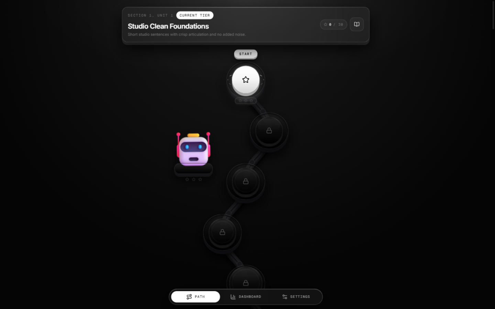
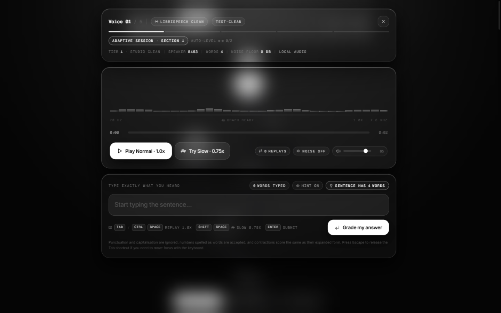
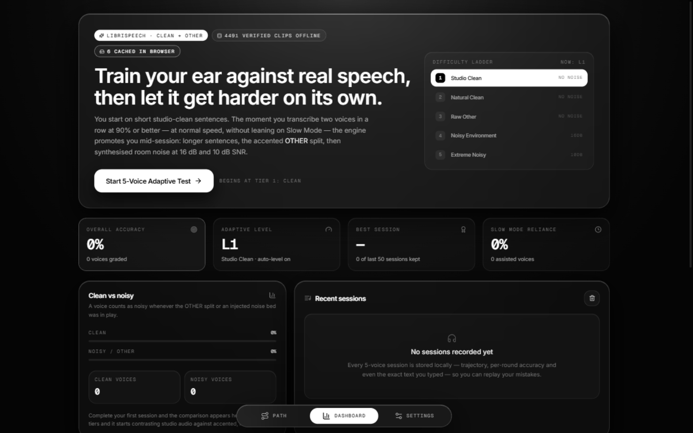

# Listeningo

A Duolingo-style listening trainer built on [LibriSpeech](https://www.openslr.org/12). You
hear a real recording, type what you heard, and get a word-level diff of your sentence
against the truth. Every voice is a genuine LibriSpeech reader, and all 4,491 of them ship
with the app as about 73 MB of WebM/Opus, so a lesson plays from local files instead of
waiting on a network round trip.

Running at [adaptive-listening-lab.vercel.app](https://adaptive-listening-lab.vercel.app).

The part that makes it more than a dictation box is that the difficulty moves while you
work. Transcribe two voices in a row at 90% or better, at normal speed and without leaning
on Slow Mode, and the engine promotes you mid-session: longer sentences first, then the
accented `other` split, then a synthesised noise bed on top. Two voices below 55% and it
steps back down. There is no account, no backend, and nothing to sign up for. Progress
lives in your own browser.



## Why this exists

LibriSpeech was collected so that machines could learn to hear speech, and it worked. A lot
of the models transcribing audio today were trained on material like this, which makes it a
fair test of a human ear: if a model can read these recordings back word for word, a person
should be able to as well, and it seems reasonable to expect a human to do better. That is
the wager behind this app.

The corpus also happens to be well suited to ear training on its own terms. These are real
readers working through real books rather than actors enunciating for a test, and the
sentences are cut from running prose. Practising on them makes ordinary spoken English
easier to follow, which is what the ladder is for: short and clean at the bottom, accented in
the middle, long and noisy at the top.

## A round, start to finish

The app opens on a Duolingo-style path: five units of ten nodes each, fifty lessons over the
whole corpus. You press a node, a voice plays, and you type the sentence. Grading happens on
submit, and the diff is the interesting part. Words you got right stay white, words you got
wrong go red, words you missed are flagged as missing, and words you invented show up as
extras. Every miss tells you which one to listen for next time.

Noise, speed and replays are all under your control during the round. Playback is 1.0x by
default, with pitch-preserved slow speeds at 0.75x, 0.65x, 0.6x, 0.5x and 0.4x. Tier 4 and 5
carry a synthesised noise bed you can boost or mute. You can replay as often as you like,
though replays and Slow Mode together decide whether a round counts toward promotion.

Session length is a setting, anywhere from 1 to 30 voices, defaulting to 5. The count is
frozen when a session starts so changing it mid-run cannot move the finish line.



Keyboard: `Tab` or `Ctrl+Space` replays at full speed, `Shift+Space` plays slowly, `Enter`
submits, and the arrow keys page back through voices you have already answered. Reviewing a
past round cannot change its score, which the card says out loud so nobody sits there
puzzling over it.

## Quick start

```bash
npm install
npm run dev          # http://localhost:3000
```

Nothing else is required. No environment variables, no API keys, no database. The page is
statically prerendered and the corpus is committed to the repository, so a production build
is the same thing with the dev server removed:

```bash
npm run build && npm start
```

Deploying works on any static host. On Vercel, `vercel --prod` or a Git import does the job
with no configuration at all, which is deliberate: the whole app is client-side, so there
are no serverless functions, no timeouts and nothing to pay for beyond bandwidth.

## How the difficulty moves

The auto-level engine runs after every single voice, not at the end of a session, so a
promotion lands while you are still sitting there listening.

| Signal | Rule |
|--------|------|
| Promote | 2 voices at 90%+, or 3 voices at 85%+ |
| Demote | 2 voices below 55% |
| Counts as clean | No Slow Mode and at most 2 replays |
| Stars on a node | 70%, 85%, 90% |

An assisted round pauses the streak rather than resetting it, so asking for help once delays
mastery instead of erasing it. A clean round that simply misses the bar does reset it.

Stars reuse the same 70/85/90 numbers on purpose. Three stars on a node means exactly what a
promotion means, which is easier to reason about than a separate scoring curve. XP is
accuracy weighted by tier (`accuracy * 100 * (1 + (tier - 1) * 0.35)`), reduced to 60% on a
round where you used Slow Mode.

## The path

Fifty nodes, five sections, ten per section. The first five are the core loop, the rest are
variations that keep the ladder from feeling like the same lesson ten times:

| Slot | Node | What it is |
|------|------|------------|
| 1 | Adaptive Session | Standard run with the live engine |
| 2 | Core Practice | Balanced draw across the tier's range |
| 3 | Mastery Workout | Re-ranked toward the words you have actually missed |
| 4 | Milestone Reward | Tap for bonus XP and the tier's mastery badge |
| 5 | Tier Boss | Drawn from the hardest 40% of the tier |
| 6 | Extension Practice | More voices across the whole range |
| 7 | Mastery Workout II | A second pass over your weak words |
| 8 | Second Milestone | A second chest, more bonus XP |
| 9 | Boss Preparation | Weak-word rank, long sentences first |
| 10 | Final Boss | The hard end of the range again |

The workout's targeting is real rather than decorative: on each render it re-runs the same
word-level alignment over your recent history, collects the words you missed or got wrong
more than once, and re-ranks candidate clips so sentences containing them come first.

Clearing a node opens the next one regardless of your score. Sitting through the voices is
the work; gating the map behind an accuracy you cannot reach yet turns practice into a wall.
A section's reward chest is an optional detour, never a gate. The next section opens once its
Mastery Workout is done, and the live engine can fast-track you sooner if you are clearly
under-challenged.

Each unit also has an animated companion sitting on a docked platform next to the path. They
are there for flavour, but they are built to fail politely: a hand-written CSS rig renders on
the first frame and the higher-resolution artwork fades in over it if it loads. Blocked
network, slow network, no difference. Hover or tap one and it hops.

Interface sounds are synthesised with the Web Audio API at the moment they play. There is not
a single audio asset in the repository for them. Node presses are a short mechanical click, a
correct voice gets a three-note chime, a promotion gets a rising sweep. Every cue peaks at a
few percent of full scale so it never competes with the speech, and one toggle turns the lot
off.

## The corpus

4,491 clips is the entire eligible pool from LibriSpeech's four evaluation splits, not a
sample of it. Sizes below are measured from the shipped files.

| Tier | Splits | Words | Clips | Speakers | Source FLAC | Shipped as Opus |
|------|--------|-------|-------|----------|-------------|-----------------|
| 1 Studio Clean | clean | 3-6 | 412 | 69 | 20.1 MB | 3.4 MB |
| 2 Natural Clean | clean | 7-11 | 1,030 | 79 | 67.5 MB | 11.3 MB |
| 3 Raw Other | other | 9-14 | 1,200 | 66 | 94.4 MB | 15.8 MB |
| 4 Noisy Environment | other | 15-18 | 670 | 66 | 70.5 MB | 11.8 MB |
| 5 Extreme Noisy | other | 19-30 | 1,179 | 66 | 172.2 MB | 28.9 MB |
| | | | **4,491** | **145** | **424.7 MB** | **73.4 MB** |

LibriSpeech ships 16 kHz mono FLAC. It is lossless, so there is nothing to squeeze out of it,
but the source material is narrowband speech, which is exactly what Opus was designed for.
Re-encoding every clip to WebM/Opus at 24 kbps mono shrinks the set by roughly six times. A
measured clip goes from 47,022 bytes to 7,707 bytes, and 425 MB of source audio becomes the
73.4 MB you see above. Audio is shipped as WebM rather than Ogg because Safari has never
played Ogg/Opus in a media element but has handled WebM/Opus since 14.1.

### How the clips were chosen

`scripts/harvest.py` walks all 11,126 utterances in the four evaluation splits and curates
them against the signals this dataset actually provides.

LibriSpeech transcripts have no punctuation and are cut at silence boundaries, often
mid-paragraph, so "is this a complete sentence" has to be inferred. The tell is how a
transcript ends: a clip closing on "and" or "of the" was cut mid-clause and sounds like a
fragment no matter how clean the audio is. Nothing in the shipped corpus ends on an article
or preposition.

Language is the other filter. LibriSpeech is curated as English but is not exclusively
English, and the crawl turned up Italian, Greek and Latin fragments, plus degenerate noise
like "SQUEAK SQUEAK". Detection runs in two stages because running it on everything is
wasteful: first a corpus-derived lexicon (a word appearing in three or more utterances counts
as English vocabulary) narrows 11,126 utterances to 82 suspects, then real language
identification runs on just those 82. It dropped 15.

The rest of the curation spreads each tier across its whole length range in round-robin
fashion, and caps how many clips any one reader or book can contribute, so no single voice
dominates a tier. Caps relax in stages when a tier would otherwise come up short.

A note on speaker count, since it looks low next to the clip count: the evaluation splits
contain 79 clean readers and 66 from the `other` split. More clips from the same pool buy
sentence variety and repetition headroom, not new voices. That is a property of the dataset,
not a choice made here.

## Grading is about hearing, not spelling

A learner who hears a word correctly and spells it badly has demonstrated the skill under
test, so the grader accepts three kinds of match and paints them differently.

| Colour | Meaning |
|--------|---------|
| White | Exact match |
| Amber, wavy underline | The right word, spelled differently. Counted correct; your spelling rides alongside in a badge |
| Red | A different word, or one missing or added. Counted against the score |

Amber is earned two ways. Orthographic closeness handles "goverment" for "government" and
"recieve" for "receive", with a tolerance that scales with word length; the opening letter
has to survive, so "table" and "cable" stay different words, and anything under four letters
must be exact because `cat`/`cut`/`cot`/`kit` is a dense neighbourhood.

The second way is phonetic, and it carries real weight. Measured against the corpus, "write"
and "right" are four edits apart, so no edit distance worth using will connect them, yet no
learner can tell them apart by ear. A Metaphone-flavoured key collapses both to the same
sound and accepts their/there, sea/see, knight/night and bare/bear along the way. The key
keeps each word's first vowel, because dropping all vowels makes `cat` and `cut` identical
when they are different words with different stressed vowels.

## The Persian layer

Once a round is graded you can reveal the sentence in Persian, and every ground-truth word is
tappable for a per-word meaning. It resolves in three layers, which is what lets it work
offline with no API key:

```
pre-generated asset -> localStorage cache -> live lookup
(the whole corpus)     (per device)          (Google, then MyMemory)
```

`scripts/translate.py` translates the curated corpus ahead of time. The shipped asset covers
4,477 of the 4,491 clips (99.7%) plus a glossary of about 960 words, and those resolve with
zero network calls. The 14 uncovered utterances are the ones the translation service handed
straight back, mostly proper-noun soup, and the guard refuses to store an echo as a
translation. Anything else, such as a clip discovered live from the dataset or a word outside
the glossary, reaches the network once and is then cached on the device permanently.

Two guards exist because a failing translation endpoint does not return an error. It returns
the input, sometimes lightly tidied, so "THEE STUDY MEDICINE" comes back as "THE STUDY
MEDICINE". A translation is only stored when it contains Persian script and does not share
most of its words with the source. A gloss that is a definition rather than an equivalent is
dropped by a length ceiling. The data is machine-generated and the interface says so: the
full-sentence translation is always one click away for the cases where a single word is
genuinely ambiguous.

## Project structure

```
Listeningo
├─ src/
│  ├─ app/                     the Next.js app router entry
│  │  ├─ layout.tsx            vendored fonts, metadata, ambient background
│  │  ├─ page.tsx              renders the shell
│  │  ├─ globals.css           design tokens, glass surfaces, diff colours
│  │  └─ fonts/                Inter, Geist Mono, Vazirmatn (woff2, committed)
│  ├─ components/              19 components plus shared primitives in ui/
│  │  ├─ AppShell.tsx          owns engine, pool, session and path progress
│  │  ├─ PathView.tsx          the winding path and its unit banners
│  │  ├─ PathConduit.tsx       four-layer 3D conduit and stepping stones
│  │  ├─ PathNode.tsx          node states, pedestal, star ribbon, START pill
│  │  ├─ PathCharacter.tsx     companions: CSS rig, optional artwork on top
│  │  ├─ ListeningArena.tsx    one round, global keyboard shortcuts
│  │  ├─ AudioStage.tsx        transport, spectrum, replay and noise monitors
│  │  ├─ DiffCard.tsx          word-level diff, score, round paging
│  │  ├─ PersianPanel.tsx      RTL sentence reveal and per-word glosses
│  │  ├─ SessionSummary.tsx    trajectory, node outcome, per-voice replay
│  │  ├─ Dashboard.tsx         ladder, KPI grid, clean vs noisy, history
│  │  ├─ SettingsView.tsx      session length, adaptive, acoustic, offline, storage
│  │  ├─ GuidebookModal.tsx    per-unit reference, focus-trapped
│  │  ├─ NavBar.tsx            the floating bottom dock
│  │  ├─ SessionOverlay.tsx    full-screen shell for the arena and summary
│  │  ├─ LevelShiftBanner.tsx  promotion and demotion announcements
│  │  ├─ RoundHeader.tsx       round metadata strip
│  │  ├─ SpectrumVisualizer.tsx
│  │  ├─ TranscriptInput.tsx
│  │  └─ ui/                   GlassCard, Pill, Toggle, Bar, icons
│  ├─ lib/
│  │  ├─ path.ts               node definitions, unlock rules, stars, weak words
│  │  ├─ scoring.ts            alignment, adaptation rules, XP
│  │  ├─ fuzzy.ts              edit distance, phonetic keys, tolerant matching
│  │  ├─ session.ts            deterministic, node-aware clip pool
│  │  ├─ levels.ts             tier definitions, noise intensity, slow rates
│  │  ├─ conduit.ts            shared 420px path grid, segment states
│  │  ├─ text.ts               normalisation, numbers, contractions
│  │  ├─ english.ts            the English-vocabulary lexicon
│  │  ├─ audio/engine.ts       Web Audio graph, transport, spectrum
│  │  ├─ audio/noise.ts        noise synthesis, RMS metering, SNR solve
│  │  ├─ audio/opus.ts         WebCodecs Opus encode and WebM muxer
│  │  ├─ localAudio.ts         bundled clip resolution
│  │  ├─ hf.ts                 dataset resolver, signed-URL fetching
│  │  ├─ manifest.ts           two-layer corpus, measured size model
│  │  ├─ idb.ts                IndexedDB clip cache, LRU
│  │  ├─ offline.ts            bulk tier download for offline play
│  │  ├─ translationService.ts English to Persian resolution
│  │  ├─ storage.ts            localStorage document, validation, quota pruning
│  │  ├─ uiSoundEngine.ts      synthesised interface cues
│  │  ├─ hooks.ts              shared React hooks
│  │  └─ types.ts              shared types
│  └─ data/                    bundled 60-clip core and its translations
├─ public/
│  ├─ audio/                   4,491 WebM/Opus clips, 73.4 MB
│  ├─ manifest.json            the full corpus index, 1,005 KB
│  └─ fa.json                  pre-generated Persian translations
├─ scripts/
│  ├─ harvest.py               crawls the dataset and curates the manifest
│  ├─ translate.py             builds the Persian assets, resumable
│  ├─ bundle-audio.mjs         encodes the corpus with ffmpeg
│  ├─ fetch-fonts.mjs          re-vendors the webfonts
│  ├─ run-verify.cjs           test runner; runs the suites below through jiti
│  └─ verify*.ts               five assertion suites, 650 checks
├─ docs/                       the screenshots above
├─ next.config.mjs             cache headers, compiler and dev-indicator options
├─ tailwind.config.ts
├─ eslint.config.mjs
├─ tsconfig.json
├─ package.json
├─ LICENSE
└─ README.md
```

## Under the hood

Clips resolve in a fixed order: bundled file first, then the IndexedDB cache, then the
Hugging Face datasets server as a fallback for a trimmed build or a clip discovered at
runtime. In a normal session only the first of those ever runs, and everything the app does
with audio happens in the browser.

The audio graph keeps the noise bed on a parallel branch that the media element never feeds,
so a cross-origin source cannot break it. The media element is only routed through Web Audio
once the context is confirmed running; otherwise playback continues natively and the
visualiser falls back to a synthetic envelope. Creating a MediaElementSource on a suspended
context is the standard way to get an app that looks alive and is silent.

Progress is one localStorage document, read once behind a mount guard so the server and
client render identically. The seen-clip window is capped at 500 ids and session history at
50; if the quota is hit, the write retries with a smaller document and the in-memory state
adopts whatever actually landed. Settings can export the document as JSON and import it back
through the full validator, so a hand-edited file cannot inject a nonsense tier or star count.

Lesson voices are random by default, drawn fresh each time you open a lesson while skipping
clips in the seen window. Turn that off and each node draws a seeded, deterministic set
instead, so reopening a lesson replays the same clips across reloads and devices. Either way
a single session never repeats a voice.



## Verification

`npm test` runs 650 assertions across five suites: progression and unlock rules, the path
geometry, tolerant matching, the translation layer, and session length. They execute the real
TypeScript modules through `jiti`, so what is asserted is what ships.

```bash
npm run typecheck    # tsc --noEmit, strict
npm run lint         # eslint
npm test             # 650 assertions
npm run build        # production build
```

The build is also checked by hand at the boundaries: with the network blocked the round shows
a retry state rather than playing a substitute voice, there is deliberately no
speech-synthesis fallback anywhere in the product, and every voice a learner hears is genuine
LibriSpeech audio.

## Regenerating the data

Both generators are resumable, so an interruption costs you the requests in flight and
nothing else.

| Command | What it does |
|---------|--------------|
| `npm run harvest` | Crawl the dataset and rebuild the clip manifest |
| `npm run translate` | Rebuild the Persian translations |
| `npm run bundle-audio` | Re-encode the corpus into `public/audio` (needs ffmpeg with libopus, and a local LibriSpeech tree) |
| `npm run fetch-fonts` | Re-vendor the webfonts, which are committed and rarely need refreshing |

`bundle-audio` takes a while and expects `LIBRISPEECH_ROOT` to point at your copy of the
dataset if it is not in the default location. It skips any clip that already has an output
file over 512 bytes, so an interrupted run picks up where it stopped.

## Configuration

None is required. There is exactly one variable the client understands, and it is only used
when a clip has no bundled file:

| Variable | Default | Purpose |
|----------|---------|---------|
| `NEXT_PUBLIC_HF_DATASETS_SERVER` | `https://datasets-server.huggingface.co` | Point at a mirror or your own proxy |

## Things worth knowing before you use it

The source audio is 16 kHz mono, downsampled from LibriVox recordings by the dataset authors.
It will sound narrower than modern audio because it is. That is inherent to LibriSpeech, not
a defect in the pipeline, and the `clean` splits are its best-recorded material.

LibriSpeech is read audiobook English. It trains careful listening against literary prose,
which is a different skill from following a conversation in a noisy cafe. Tier 4 and 5 add
synthesised noise, but the speech underneath is still a person reading a book.

Opus compaction in the browser needs WebCodecs (Chrome, Edge, Firefox 130+, Safari 16.4+ for
encoding; WebM/Opus playback since Safari 14.1). Where it is missing, cached clips are stored
as FLAC instead and everything works identically at roughly six times the storage. The
Settings screen reports which path is active rather than silently doing nothing.

The Hugging Face datasets server rate-limits by IP. The bundled corpus means you never touch
it in normal use, but the fallback path has a deliberately tight retry budget so a slow host
surfaces a retry button quickly instead of stalling the round.

Nothing else leaves the device. In a normal session the only third-party request is the
optional companion artwork; block it and the app quietly uses the CSS rig instead.

## Credits and license

Audio is [LibriSpeech](https://www.openslr.org/12) (OpenSLR SLR12), licensed CC BY 4.0 by its
authors. The corpus here is re-encoded to WebM/Opus and redistributed under the same license;
the Hugging Face datasets server stays behind it as a fallback. Injected noise is synthesised
locally with the Web Audio API. Persian translations are machine-generated, with Google
Translate as the primary source and MyMemory as the fallback.

Companion artwork comes from [Animated Fluent
Emojis](https://github.com/Tarikul-Islam-Anik/Animated-Fluent-Emojis) (MIT). The three
vendored webfonts, Inter, Geist Mono and Vazirmatn, are all SIL Open Font License.

The code in this repository is MIT licensed. See [LICENSE](LICENSE).
